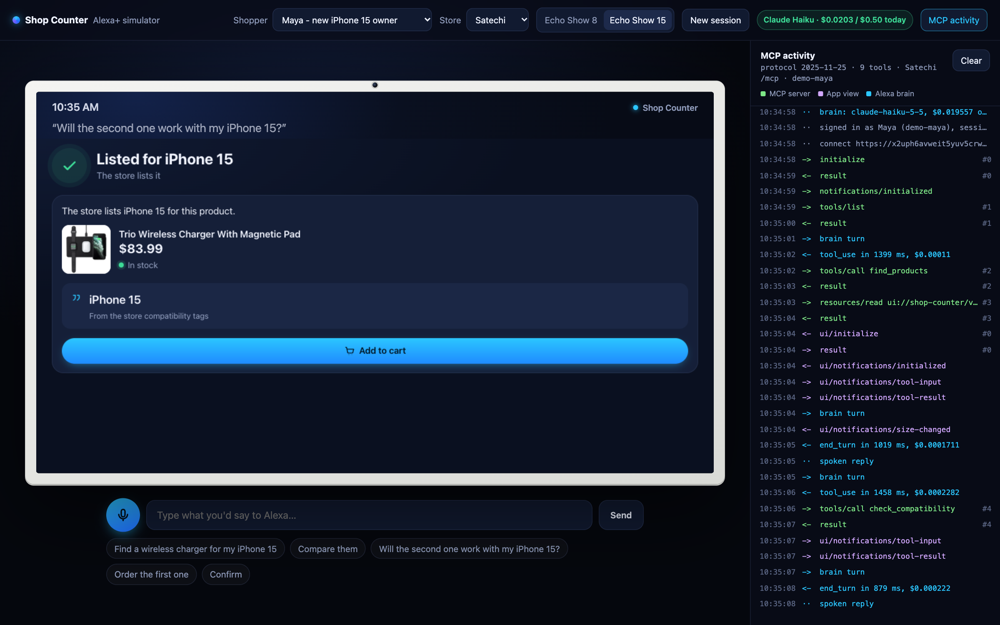

# Shop Counter

**"Alexa, will this work with my stuff?" Shop Counter remembers the devices you own and says yes only when the store itself lists your exact model, with the store's words on screen to prove it.**

- **Try it in your browser (nothing to install, no keys):** https://x2uph6avweit5yuv5crwm474240pwtzb.lambda-url.us-east-1.on.aws/sim/
- **Live MCP server (AWS Lambda):** https://x2uph6avweit5yuv5crwm474240pwtzb.lambda-url.us-east-1.on.aws/mcp
  (Roborock: `/stores/roborock/mcp`, health: `/health`)
- **Demo video (2:52):** https://youtu.be/KcCVoWnQfLI
- **How it was built, day by day:** [docs/BUILD_LOG.md](docs/BUILD_LOG.md)

The Alexa+ MCP toolkit is closed to participants, so the repo ships a real MCP client standing in for Alexa:
an Echo Show simulator (`apps/echo-sim`) that speaks MCP over Streamable HTTP and hosts the MCP App screens.
The server itself is a plain self-hosted MCP server (spec 2025-11-25) that Alexa+ would connect to.



## Try it in your browser

Open **https://x2uph6avweit5yuv5crwm474240pwtzb.lambda-url.us-east-1.on.aws/sim/** in Chrome. Voice input needs Chrome (Web Speech API); typing works in any browser.
The page, the MCP server and the model that plays Alexa all run on one AWS Lambda Function URL.

- **Alexa is Claude Haiku 5.5, called from the Lambda.** The simulator sends each turn to `POST /brain/turn` on the
  same Lambda, which calls the Anthropic API; the key lives only in the function's environment, never in the browser.
  The badge at the top names the model and shows today's spend.
- **Spend is capped**: $0.50 a day and 60 model turns an hour per visitor, counted in DynamoDB. Over a cap the
  simulator switches to its keyword router (no LLM) and the demo keeps working.
- Maya and Sam are private to your browser: each visitor starts as a fresh shopper under that name, kept for 24 hours.
  Press **L** to see every MCP JSON-RPC message.

## Try the live server in 3 requests

```bash
U=https://x2uph6avweit5yuv5crwm474240pwtzb.lambda-url.us-east-1.on.aws

# 1. A private guest session (an empty closet of your own)
TOKEN=$(curl -s -X POST $U/auth/demo-login -H 'content-type: application/json' -d '{"profile":"guest"}' \
  | python3 -c 'import sys, json; print(json.load(sys.stdin)["token"])')

# 2. initialize: the server answers protocolVersion "2025-11-25"
curl -s -X POST $U/mcp -H "authorization: Bearer $TOKEN" -H 'content-type: application/json' \
  -H 'accept: application/json, text/event-stream' \
  -d '{"jsonrpc":"2.0","id":1,"method":"initialize","params":{"protocolVersion":"2025-11-25","capabilities":{},"clientInfo":{"name":"curl","version":"0"}}}'

# 3. Does the Satechi OntheGo 67W Slim Wall Charger (variant 43950442643544) work with an iPhone 15?
curl -s -X POST $U/mcp -H "authorization: Bearer $TOKEN" -H 'content-type: application/json' \
  -H 'accept: application/json, text/event-stream' -H 'mcp-protocol-version: 2025-11-25' \
  -d '{"jsonrpc":"2.0","id":2,"method":"tools/call","params":{"name":"check_compatibility","arguments":{"product_id":"43950442643544","device":"iPhone 15"}}}'
```

Answers come as one Server-Sent Event (`event: message` / `data: {...}`), which is how the SDK replies to 2025-11-25
clients even without streaming. The third one says "Yes, the store lists the iPhone 15 for the OntheGo 67W Slim Wall
Charger." and carries the store's tag as the quote. Try `"device":"iPhone 17 Pro"` too: the store tags only
"iPhone 17", and the answer says so instead of a yes.

> Not affiliated with Satechi or Roborock. The demo reads their **public** Shopify catalogs
> (`/products.json`, politely: one request per page, 1 s apart, 6 h cache). Orders and payment are simulated.

## Run it (3 commands)

```bash
npm install
cd apps/shop-counter && npm run dev        # MCP server: http://127.0.0.1:8787/mcp  (Roborock: /stores/roborock/mcp)
cd apps/echo-sim && npm run dev            # Echo Show simulator: http://localhost:5180  (?video for a clean frame)
```

Optional: `cd apps/echo-sim && npm run brain` with `ANTHROPIC_API_KEY` set lets Claude Haiku play Alexa
(capped at $0.50 a day). Without a key a small keyword router stands in, so the demo always works. Both brains,
this local one and the one on Lambda, build the same system prompt (`skills/shop-counter/system-prompt.mjs`).

Try it as in the video: pick **Sam**, say *"I have a Roborock Saros 10R"* at Satechi, switch the store to **Roborock**
and ask *"What devices do I have?"*: the closet is there, plus one part Roborock itself lists for the Saros 10R, with
the quote. Then *"Will the Accessories Pack for Saros 10 fit my robot?"*: no, in the store's own words. As **Maya** at
Satechi, say *"I just got an iPhone 15"*, then *"Will this charger work with my phone?"*, no model named.

## What it does

| Shopper says | Shop Counter |
|---|---|
| "Will this work with my phone?" | Uses the remembered iPhone 15. "The store lists your iPhone 15 for the OntheGo 67W Slim Wall Charger." The screen shows the store's line. |
| "Will it work with my iPhone 17 Pro?" | The store tags only "iPhone 17": "The store lists iPhone 17, not your iPhone 17 Pro specifically." Never a yes. |
| "my phone", with two phones remembered | "Which phone should I check: your iPhone 15 or Galaxy S24?" It asks instead of picking one. |
| "Does this pack fit my robot?" | "No, that won't work with your Saros 10R: the store says "Not compatible with Saros 10R"." plus a part the store does list. |
| "What do I have?" (in another store) | The same closet, an icon per device kind, and one tip: an in-stock accessory this store lists for one of your devices. Never invented. |
| "Find a charger under $50" | Up to 3 picks with reasons, from the live feed. Unknown is said as unknown. |
| "Order the first one" -> "confirm" | A priced preview first ("Say confirm to buy"), the order only after a yes. Simulated payment. |

Every price, stock flag and compatibility claim is checked against the raw store feed by an eval
(`npm run eval`: 68 shopper requests, 0 fabricated facts).

## Architecture

```
Echo Show simulator (apps/echo-sim)          Alexa+ (real add-on, via account linking)
  MCP client, MCP App host, voice                     |
          |  Streamable HTTP, Authorization: Bearer <signed session>
          v
Shop Counter server (apps/shop-counter)  ->  AWS Lambda Function URL + DynamoDB (deploy/)
  stores: Satechi /mcp, Roborock /stores/roborock/mcp
  also on the Lambda: /sim/ (the simulator page), /brain/turn (Claude Haiku 5.5)
          |
Shelf to Alexa library (packages/shelf)   Shopify feed -> normalize -> extract -> search -> 9 MCP tools
MCP App view (packages/view)              one HTML file draws every result kind for Echo Show
```

- **MCP 2025-11-25**: `apps/shop-counter/src/app.ts` builds one stateless `McpServer` per request
  (`@modelcontextprotocol/server` 2.3.1); tools in `packages/shelf/src/server.ts`; contract in `docs/CONTRACT.md`.
- **MCP Apps**: `registerAppTool` / `registerAppResource` (`@modelcontextprotocol/ext-apps` 2.0.3) serve
  `ui://shop-counter/view.html`; the simulator hosts it in a sandboxed iframe through `AppBridge`.
- **Alexa brain**: `apps/shop-counter/src/brain.ts` on Lambda calls Claude Haiku 5.5 through the Anthropic API in the
  same Messages format the simulator speaks, so `tool_use` blocks go back to the browser and run through its real MCP
  client. Amazon Bedrock paths are built and tested behind a flag (`BRAIN_PROVIDER=anthropic` for Claude in Amazon
  Bedrock, `nova` for Nova Lite), but our new AWS account gets "not available for this account" for every Bedrock
  model, so the live brain uses the API.
- **Agent Skill**: `skills/shop-counter/SKILL.md` tells the Alexa+ model which tool to call when, and what never to make up.
- **Identity**: account linking over OAuth 2.1 (next section), or the demo login (`POST /auth/demo-login`,
  profiles `maya`, `sam`, `guest`) as a fallback. Both give an HMAC-signed token; the server takes the shopper
  only from `Authorization: Bearer`. Forged, expired or wrong-audience tokens get 401.
- **Memory**: the closet is keyed by shopper and shared by all stores; orders are per store. Files locally,
  DynamoDB on AWS (`STATE_STORE=dynamodb`, `TABLE_NAME`).

## Account linking (OAuth 2.1)

Alexa+ links a shopper's account to a skill with OAuth. Shop Counter has a small authorization server in the same
Lambda, written to the MCP Authorization spec 2025-11-25 (`apps/shop-counter/src/oauth.ts`, contract section Auth):

- `/.well-known/oauth-protected-resource` (also `/mcp` and `/stores/<id>/mcp` under it) and
  `/.well-known/oauth-authorization-server` for discovery;
- clients register with a Client ID Metadata Document (an https URL as `client_id`) or `POST /register`;
- `/authorize` shows a consent page, "Link Shop Counter to Alexa", where you pick Maya, Sam or a new guest;
- `/token` swaps the code for a 1-hour access token. PKCE S256 is required, the `redirect_uri` must match
  exactly, codes and refresh tokens work once, and a token issued for one store is refused at another.

In the simulator, press **Link account**: it runs the whole flow in the browser (discovery, registration, PKCE,
consent, token) and the MCP activity panel shows each step. Without a token the server still answers search and
compatibility questions as `anonymous`; the closet and orders ask you to sign in. A 401 always names the metadata
URL in `WWW-Authenticate`. The curl sample above keeps using the demo login.

## Connect any Shopify store

Add an entry to `apps/shop-counter/src/stores.ts`:

```ts
{ id: 'mystore', name: 'My Store', url: 'https://mystore.com', currency: 'USD', region: 'US', shipping: null, demo_delivery_days: 4 }
```

It is served at `/stores/mystore/mcp`. The library alone (`packages/shelf`, npm name `shelf-to-alexa`) turns any
storefront into the same 9 tools; see `packages/shelf/README.md`. Check the store's terms before you read its feed.

## Deploy to AWS (optional)

`cd apps/shop-counter && npm run package` builds `dist/function.zip` (one ESM bundle, arm64-ready). Upload it with
`deploy/deploy_lambda.sh` to AWS CloudShell and run the script: it creates the DynamoDB table (on-demand), a role
limited to that table, the Lambda (Node 22, arm64, reserved concurrency 5 when the account allows it), a public Function URL with CORS,
log retention, and a kill switch alarm that turns the function off above an hourly cap. The same zip carries the
simulator (served at `/sim/`) and the brain. The Anthropic key is pasted once in the Lambda console and kept on re-deploy.

## Tests

```bash
npm test                                   # all packages: library, server, view, simulator router
npm run eval                               # 68 shopper requests on a frozen catalog snapshot, no network
cd apps/shop-counter && npm run check      # live end-to-end check against the real Satechi storefront
```

## Build log

[docs/BUILD_LOG.md](docs/BUILD_LOG.md): the spike, the core, the honesty eval (17 of 39 at first, 2 made-up facts),
two outside reviews and what they broke, the AWS deploy and the video, in order. The friction we hit along the way
is in [docs/submission/friction_log.md](docs/submission/friction_log.md).

## License

MIT, see [LICENSE](LICENSE).
